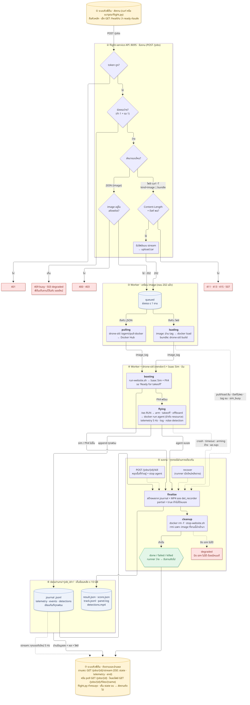
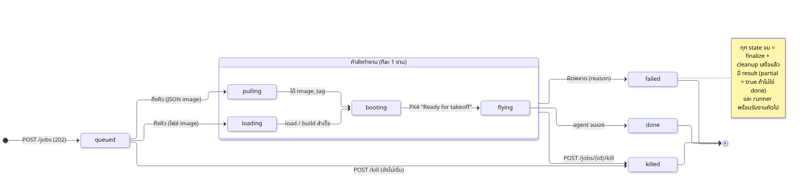
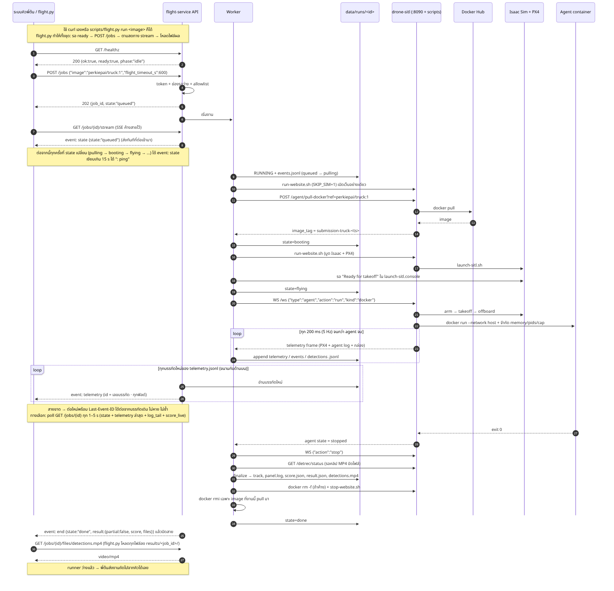
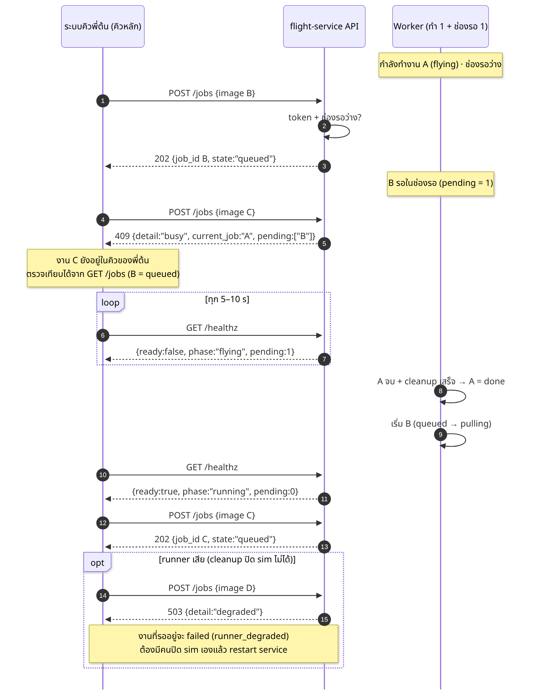
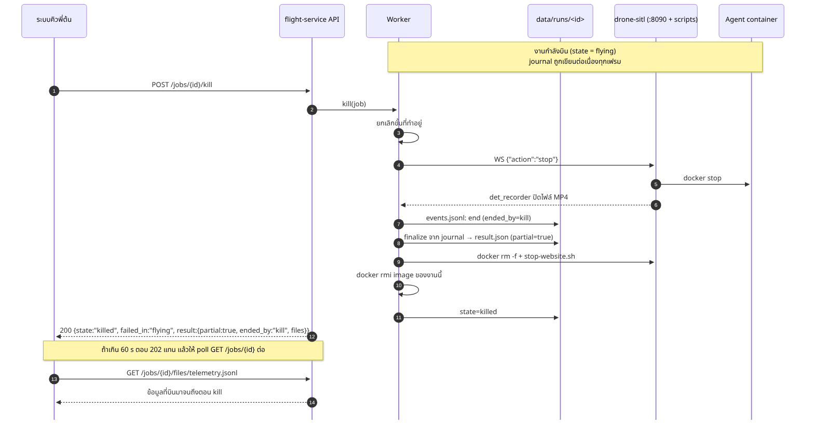
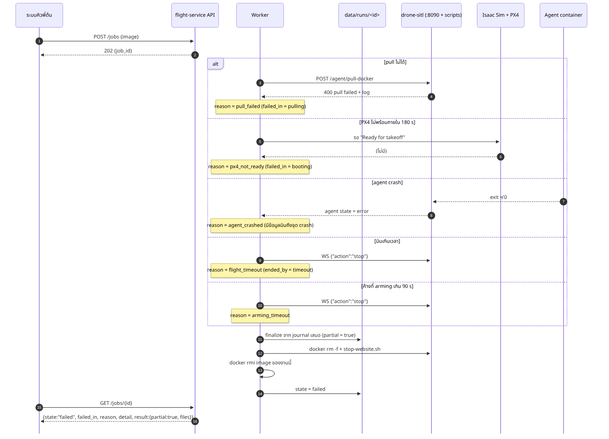
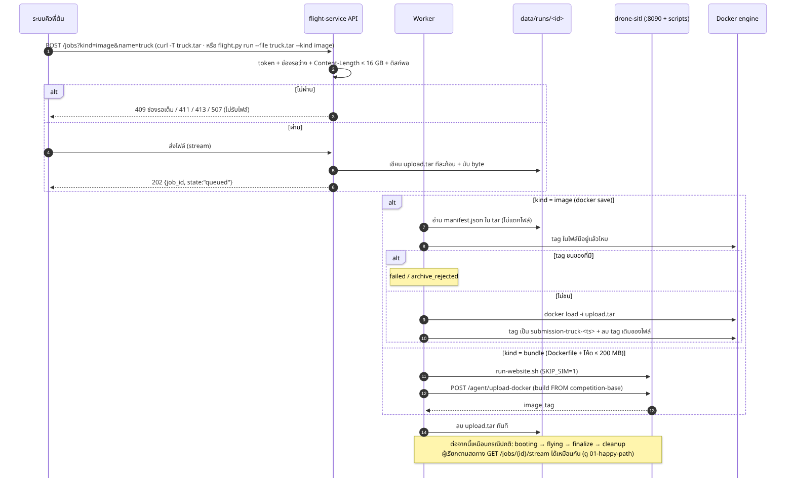
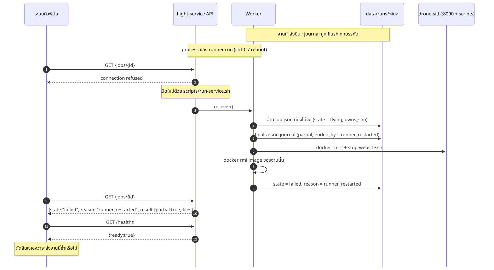

# flight-service API (สรุป · 2026-10-05)

> **หน้าที่ของ flight-service:** รับ docker image มาบินใน sim **ทีละ 1 งาน** แล้วส่งผลกลับ
> **คิวหลักอยู่ที่ระบบของพี่ต้น:** ฝั่งเรามีช่องรอเล็ก 1 งาน (`MAX_PENDING=1`) กันจังหวะชน ถ้าช่องเต็มตอบ `409 busy` ให้พี่ต้นถือคิวไว้แล้วส่งใหม่เมื่อ `GET /healthz` ตอบ `ready: true`
> รายละเอียดเต็มอยู่ใน [design.md](design.md) · ภาพ mermaid ต้นฉบับอยู่ใน [diagrams/](diagrams/) (แปลงภาพใหม่ด้วย `diagrams/render.sh`)

## 0. ภาพรวม: ทุกส่วนและทุกกรณีในภาพเดียว



อ่านจากบนลงล่าง:

| # | ส่วน | ทำอะไร |
|---|---|---|
| ① | ระบบคิวพี่ต้น · ส่งงาน | ถือคิวหลัก เช็ก `ready` แล้วยิง `POST /jobs` |
| ② | flight-service API | ตรวจ token → ช่องรอว่างไหม → JSON หรือไฟล์ → allowlist / ขนาด + ดิสก์ (ไม่ผ่าน = ตอบ 4xx/5xx ทันที ไม่สร้างงาน) |
| ③ | Worker · เตรียม image | `pulling` (ผ่าน drone-sitl จาก Docker Hub) หรือ `loading` (docker load / build bundle) |
| ④ | Worker + drone-sitl + Isaac Sim | `booting` (บูต sim, รอ PX4) → `flying` (RUN ผ่าน `/ws`, agent container บิน) |
| ⑤ | จบงาน | **ทุกทางจบเข้า finalize ตัวเดียว** ได้แก่ จบเอง, ล้มทุกแบบ (เส้นประ), kill และ recover → cleanup → `done`/`failed`/`killed` |
| ⑥ | data/runs/<id>/ | journal เขียนทันทีทุกเฟรม + ผลหลัง finalize · เก็บย้อนหลัง ≤ 10 GB |
| ⑦ | ระบบคิวพี่ต้น · อ่านผล | ติดตามสดทาง stream หรือ poll สถานะ ดาวน์โหลดไฟล์ เห็น state จบแล้วส่งงานถัดไป |

## 1. Endpoint (7 ตัว ตัวละหนึ่งหน้าที่)

ทุกตัวยกเว้น `/healthz` ต้องมี header `Authorization: Bearer <RUNNER_TOKEN>`

| method | path | หน้าที่ | ตอบ |
|---|---|---|---|
| `GET` | `/healthz` | รับงานได้ไหม (ไม่ต้องใช้ token) | `200 {"ok", "ready", "phase", "pending"}` |
| `POST` | `/jobs` | **เริ่มงาน**: JSON = ชื่อ image บน registry · ไฟล์ = อัปโหลด image | `202 {"job_id", "state"}` |
| `GET` | `/jobs` | ประวัติงาน 50 งานล่าสุด (สรุปสั้น) | `200 {"jobs": [...]}` |
| `GET` | `/jobs/{id}` | สถานะ + ข้อมูลสด + ผลของงานเดียว | `200 {...}` |
| `GET` | `/jobs/{id}/stream` | **ติดตามสด** (Server-Sent Events): state, telemetry ทุกบรรทัด, ผลตอนจบ | `200 text/event-stream` แล้วปิดสายหลัง `end` |
| `POST` | `/jobs/{id}/kill` | หยุดงาน แล้วตอบด้วยข้อมูลที่เก็บได้ | `200` (หรือ `202` ถ้าเกิน 60 s) |
| `GET` | `/jobs/{id}/files/{name}` | ดาวน์โหลดไฟล์ผล (journal โหลดได้ตั้งแต่ระหว่างบิน) | ไฟล์ |

`ready` = ยิง `POST /jobs` ตอนนี้จะถูกรับ (ช่องรอว่าง) · `pending` = งานในช่องรอ (0–1) · `phase`: `idle` · `running` · `finishing` · `cleanup` · `degraded` (ต้องมีคนแก้)

### ตัวอย่าง curl

```bash
export R=http://127.0.0.1:8095  H="Authorization: Bearer $TOKEN"

curl -s $R/healthz                                               # {"ok":true,"ready":true,"phase":"idle","pending":0}
curl -s -X POST $R/jobs -H "$H" -H 'Content-Type: application/json' \
     -d '{"image":"perkiepai/truck-detector:20260929-214240","flight_timeout_s":600}'
curl -s -X POST -T truck.tar "$R/jobs?kind=image&name=truck-detector" -H "$H"   # ส่งไฟล์ docker save
curl -s -X POST -T bundle.tar "$R/jobs?kind=bundle&name=truck-detector" -H "$H" # ส่ง build bundle
curl -s $R/jobs/<id> -H "$H"
curl -sN $R/jobs/<id>/stream -H "$H"                              # ติดตามสด · ต่อใหม่: เพิ่ม -H 'Last-Event-ID: <เลขบรรทัดล่าสุดที่ได้>'
curl -s -X POST $R/jobs/<id>/kill -H "$H"
curl -s -o clip.mp4 $R/jobs/<id>/files/detections.mp4 -H "$H"
```

### ข้อมูลที่ได้

| ช่วงเวลา | ได้อะไร | ที่ไหน |
|---|---|---|
| ระหว่างบิน | state · telemetry ล่าสุด (lat, lon, alt, heading, roll, pitch, gs, vz, mode, armed) · log 20 บรรทัดท้าย · `score_live` | `GET /jobs/{id}` |
| ระหว่างบิน | ข้อมูลทุกเฟรมจนถึงตอนนั้น | `files/telemetry.jsonl`, `events.jsonl`, `detections.jsonl` |
| ตอนจบ (ทุกแบบรวม kill) | `result`: `ended_by`, `partial`, เวลาบิน, ระยะทาง, alt สูงสุด, score v0, ลิงก์ไฟล์ | `GET /jobs/{id}` |
| ตอนจบ | `track.jsonl`, `panel.log`, `detections.mp4`, `meta.json`, `score.json`, `result.json`, `analysis.txt` | `files/{name}` |

### ติดตามสด: `GET /jobs/{id}/stream`

```
event: state
data: {"state":"flying","since":"2026-10-06T02:29:52+0700","reason":null}

id: 1
event: telemetry
data: {"connected":true,"armed":true,"mode":"OFFBOARD","alt_m":20.1,"lat":14.0283442,"lon":100.4364643,"t":1791228638.13,"agent":{"state":"running"}}

: ping

event: end
data: {"job_id":"j-...","state":"done","failed_in":null,"reason":null,"detail":"","result":{"ended_by":"agent","score":{"score":95.6},"files":{},"missing":[]}}
```

| event | ส่งเมื่อ | data |
|---|---|---|
| `state` | ตอนต่อเข้ามาหนึ่งครั้ง และทุกครั้งที่ state เปลี่ยน | `{"state","since","reason"}` |
| `telemetry` | ทุกบรรทัดใหม่ของ `telemetry.jsonl` (5 Hz, ~1.3 KB) · `id` = เลขบรรทัด | บรรทัดนั้นทุกฟิลด์ (ตัวอย่างข้างบนย่อไว้) |
| `end` | งานจบและส่ง telemetry ครบแล้ว → server ปิดสาย | `job_id`, `state`, `failed_in`, `reason`, `detail`, `result` (รูปเดียวกับใน `GET /jobs/{id}`) |

- **สายขาด:** ต่อใหม่พร้อม `Last-Event-ID: <id ล่าสุดที่ได้ครบ>` จะได้ต่อจากบรรทัดนั้น ไม่หาย ไม่ซ้ำ · `state` ปัจจุบันถูกส่งก่อนเสมอ
- **`: ping`** ทุก 15 s ตอนไม่มีข้อมูล (ก่อนบิน และช่วงเก็บกวาดหลังบิน) · เงียบเกิน ~45 s ให้ถือว่าสายตายแล้วต่อใหม่
- ต่อเข้ามาหลังงานจบก็ได้: ได้ `state` → telemetry ทั้งหมด → `end`
- log ของ agent และ detections ไม่อยู่ใน stream: ดูที่ `log_tail` ของ `GET /jobs/{id}` และ `files/events.jsonl`, `files/detections.jsonl`
- client สำเร็จรูปที่ทำทั้งหมดนี้ให้: `scripts/flight.py` (ดู README)

### HTTP status ที่ต้องรับมือ

| status | เมื่อไร | พี่ต้นควรทำ |
|---|---|---|
| `202` | รับงานแล้ว | เก็บ `job_id` แล้ว poll |
| `400` / `403` / `413` / `415` / `411` | request ผิด / image ไม่อยู่ใน allowlist / ไฟล์ใหญ่เกิน / ผิดชนิด / ไม่มี Content-Length | แก้ request (ส่งซ้ำแบบเดิมไม่ช่วย) |
| `401` | token ผิด | ตรวจ token |
| `409` | **ช่องรอเต็ม** (`POST /jobs`, ตอบ `current_job` + `pending`) หรือ kill งานที่จบไปแล้ว | เก็บงานไว้ในคิวของพี่ต้น รอ `ready: true` แล้วส่งใหม่ |
| `503` | runner `degraded` | แจ้งคนดูแล |
| `507` | ดิสก์ไม่พอรับไฟล์ | แจ้งคนดูแล |

## 2. State ของงาน



- `queued` = อยู่ในช่องรอ (ได้ 1 งาน) · kill งานใน `queued` ได้ (จบทันที ไม่มีข้อมูล)
- **state จบ (`done` / `failed` / `killed`) = finalize + cleanup เสร็จแล้ว** พี่ต้นจึงส่งงานถัดไปได้ทันทีที่เห็น state จบ
- `failed` มี `failed_in` + `reason` + `detail` · reason: `pull_failed` `disk_low` `image_too_large` `sim_busy` `load_failed` `archive_rejected` `sim_boot_timeout` `px4_not_ready` `run_refused` `arming_timeout` `agent_crashed` `flight_timeout` `ws_lost` `web_start_failed` `runner_restarted` `runner_degraded` `unsupported_source` `internal_error`

## 3. Sequence diagram ของแต่ละสถานการณ์

### 3.1 ปกติ: ส่งชื่อ image → บินจบ → ได้ผล



### 3.2 ช่องรอเต็ม (คิวหลักอยู่ที่พี่ต้น)



### 3.3 Kill ระหว่างบิน → ได้ข้อมูลที่เก็บมาทันที



### 3.4 ผิดพลาดแบบต่าง ๆ → `failed` พร้อมเหตุผลและข้อมูลเท่าที่มี



### 3.5 ส่งไฟล์ image แทนชื่อ image



### 3.6 runner ตายกลางงาน → เปิดใหม่แล้วกู้ผลจาก journal


