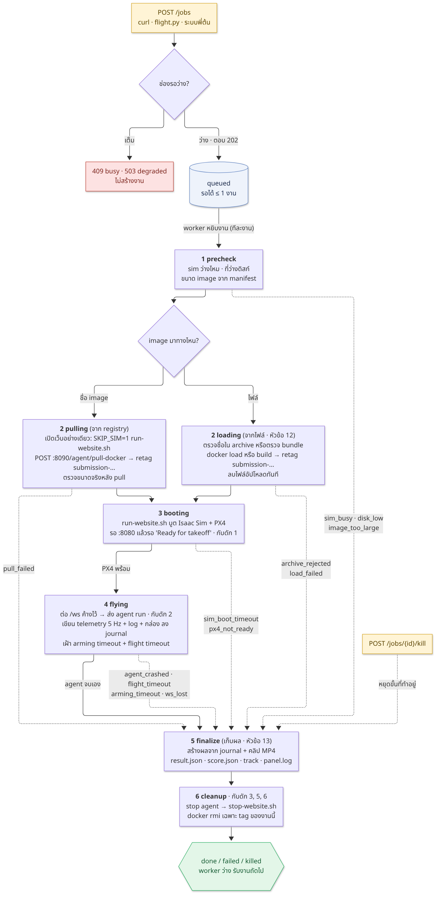

# flight-service: design และ API

> อัปเดต 2026-10-09 · ตรวจกับโค้ดและ `flight_service/config.py` ที่ branch `feat/vendor-drone-sitl`
> ฉบับเต็มก่อนรวม (design 477 บรรทัด + api 136 บรรทัด) อยู่ใน git: `git show 730435d:docs/design.md` และ `730435d:docs/api.md`

## 1. ระบบนี้ทำอะไร

HTTP service (FastAPI, port **8095**, env `drone`) รับ docker image ของผู้แข่ง บินโดรนใน sim ให้อัตโนมัติ **ทีละ 1 งาน** แล้วคืนผล

- **รับ image 2 ทาง:** ชื่อ image บน registry (service pull ให้) หรือไฟล์ที่ส่งด้วย curl (`docker save` หรือ build bundle)
- **ทุกงานบูต sim ใหม่แล้วปิดเมื่อจบ** โดรนจึงเริ่มจากแท่นเสมอ (บูต 2–5 นาทีต่องาน) ทุกขั้นมี timeout งานจึงจบเป็น `done` / `failed` / `killed` พร้อมเหตุผลเสมอ
- **คิวหลักอยู่ที่ระบบของพี่ต้น** ฝั่งเรามีช่องรอ 1 งาน (`MAX_PENDING=1`) ช่องเต็มตอบ `409 busy` ให้ถือคิวไว้แล้วส่งใหม่เมื่อ `GET /healthz` ตอบ `ready: true`
- **ใช้ drone-sitl จากสำเนาใน `vendor/drone-sitl/`** (ตั้งแต่ 2026-10-06 ตั้ง `DRONE_SITL_DIR` ชี้ที่อื่นได้) เครื่องใหม่ตรวจด้วย `scripts/preflight.sh`
- **ไม่มี login**: bind `127.0.0.1` เป็นด่านเดียว (ผู้เรียกเป็นคนในทั้งหมด)
- client สำเร็จรูป: `scripts/flight.py` (ดู README)


## 2. Flow ของหนึ่งงาน



| ขั้น | state | ทำอะไร |
|---|---|---|
| 1 | `queued` | ตรวจ allowlist · ขนาด · ดิสก์ · ไม่มี sim ของคนอื่นเปิดอยู่ (`sim_busy`) |
| 2 | `pulling` / `loading` | pull จาก registry หรือ `docker load` ไฟล์ที่อัปโหลด แล้ว retag เป็น `submission-<ชื่อ>-<ts>` · pull ก่อนบูต sim เพื่อไม่ให้ GPU ถูกจองไว้ระหว่างรอ |
| 3 | `booting` | `run-website.sh` บูต Isaac + PX4 รอบรรทัด `Ready for takeoff` |
| 4 | `flying` | ต่อ `/ws` ค้างไว้ ส่ง `agent run` เก็บ telemetry 5 Hz เฝ้า arming timeout และ flight timeout |
| 5 | (finalize) | สร้างผลจาก journal บนดิสก์ ทุกทางจบเข้าฟังก์ชันเดียวนี้ |
| 6 | (cleanup) | stop agent → `docker rm -f` เฉพาะของงานนี้ → `stop-website.sh` → `docker rmi` เฉพาะ tag ที่งานนำเข้ามา (ไม่ใช้ `prune`, ไม่ใช้ `pkill -f`) แล้ว state จึงเป็นสถานะจบ |

## 3. API (8 endpoint)

| method | path | หน้าที่ | ตอบ |
|---|---|---|---|
| `GET` | `/healthz` | รับงานได้ไหม | `{"ok","ready","phase","pending"}` |
| `POST` | `/jobs` | เริ่มงาน: `Content-Type: json` = ชื่อ image · อย่างอื่น (`curl -T`) = ไฟล์ | `202 {"job_id","state","source"}` |
| `GET` | `/jobs` | 50 งานล่าสุด (สรุปสั้น) | `{"jobs":[...]}` |
| `GET` | `/jobs/{id}` | สถานะ + telemetry ล่าสุด + `log_tail` + `score_live` + `result` | job |
| `GET` | `/jobs/{id}/stream` | ติดตามสด (SSE) | `text/event-stream` |
| `POST` | `/jobs/{id}/kill` | หยุดงาน ตอบด้วยผลที่เก็บได้ | `200` (`202` ถ้าเกิน 60 s) |
| `POST` | `/kill` | หยุดโดยไม่ระบุ id: งานที่กำลังบิน ถ้าไม่มีก็งานรอคิว (ไม่หยุดทั้งคิว) | เหมือนข้างบน · `409` ถ้าไม่มีงาน |
| `GET` | `/jobs/{id}/files/{name}` | ดาวน์โหลดไฟล์ผล (journal โหลดได้ระหว่างบิน) | ไฟล์ |

`ready` = ตอนนี้ `POST /jobs` จะถูกรับ · `pending` = งานในช่องรอ (0–1) · `phase`: `idle` `running` `finishing` `cleanup` `degraded` (ต้องมีคนแก้)

```bash
export R=http://127.0.0.1:8095
curl -s $R/healthz
curl -s -X POST $R/jobs -H 'Content-Type: application/json' \
     -d '{"image":"perkiepai/truck-detector:20260929-214240","flight_timeout_s":600}'
curl -s -X POST -T truck.tar   "$R/jobs?kind=image&name=truck-detector"    # docker save (ใช้ -T ห้าม --data-binary)
curl -s -X POST -T bundle.tar  "$R/jobs?kind=bundle&name=truck-detector"   # build bundle ≤ 200 MB
curl -s $R/jobs/<id>
curl -sN $R/jobs/<id>/stream            # ต่อใหม่: -H 'Last-Event-ID: <เลขบรรทัดล่าสุด>'
curl -s -X POST $R/kill                 # หรือ $R/jobs/<id>/kill
curl -s -o clip.mp4 $R/jobs/<id>/files/detections.mp4
```

| status | เมื่อไร | ควรทำ |
|---|---|---|
| `202` | รับงานแล้ว | เก็บ `job_id` แล้ว poll หรือ stream |
| `400` `403` `411` `413` `415` | request ผิด · image นอก allowlist · ไม่มี Content-Length · ไฟล์ใหญ่เกิน · ชนิดไม่รองรับ | แก้ request (ส่งซ้ำไม่ช่วย) |
| `409` | ช่องรอเต็ม (`current_job` + `pending`) · หรือ kill งานที่จบแล้ว | รอ `ready: true` แล้วส่งใหม่ |
| `503` / `507` | runner `degraded` / ดิสก์ไม่พอ | แจ้งคนดูแล |

### Stream สด (SSE)

| event | ส่งเมื่อ | data |
|---|---|---|
| `state` | ตอนต่อเข้ามา และทุกครั้งที่ state เปลี่ยน | `{"state","since","reason"}` |
| `telemetry` | ทุกบรรทัดใหม่ของ `telemetry.jsonl` (5 Hz) · `id` = เลขบรรทัด | บรรทัดนั้นทุกฟิลด์ |
| `end` | งานจบและส่ง telemetry ครบ แล้ว server ปิดสาย | `{"job_id","state","failed_in","reason","detail","result"}` |

สายขาดให้ต่อใหม่พร้อม `Last-Event-ID` (ไม่หาย ไม่ซ้ำ) · มี `: ping` ทุก 15 s ตอนเงียบ เงียบเกิน ~45 s ให้ต่อใหม่ · ต่อหลังงานจบก็ได้ · log ของ agent กับ detections ไม่อยู่ใน stream (ดู `log_tail` และ `files/events.jsonl`, `files/detections.jsonl`)

## 4. State


- **state จบ (`done` / `failed` / `killed`) = finalize + cleanup เสร็จแล้ว** ส่งงานถัดไปได้ทันที
- `done` = agent จบเอง (container exit 0 หรือ panel มี `] DONE`) · `killed` แยกจาก `failed` เพื่อให้รู้ว่าคนสั่งหยุด
- `failed` มี `failed_in` + `reason` + `detail`:

| reason | เมื่อไร |
|---|---|
| `disk_low` `image_too_large` | ดิสก์ว่าง < `MIN_FREE_GB` หรือ < 2× ขนาด image · image > `MAX_IMAGE_GB` |
| `pull_failed` `load_failed` `archive_rejected` | pull ล้ม/เกินเวลา · `docker load` ล้ม · tag ในไฟล์ซ้ำกับ image ที่มีอยู่หรือมีหลาย image |
| `sim_busy` `web_start_failed` `unsupported_source` | มี sim ที่เราไม่ได้เปิดรันอยู่ · เปิดเว็บ drone-sitl ไม่ได้ · ชนิดต้นทางไม่รองรับ |
| `sim_boot_timeout` `px4_not_ready` | `:8080` ไม่ตอบใน `BOOT_TIMEOUT_S` · ไม่มี `Ready for takeoff` ใน `PX4_READY_TIMEOUT_S` |
| `run_refused` `arming_timeout` `agent_crashed` `flight_timeout` `ws_lost` | AgentRun ปฏิเสธ · ค้าง arming เกิน `ARMING_TIMEOUT_S` · agent/container พัง · บินเกิน `flight_timeout_s` · ต่อ `/ws` ใหม่ไม่ได้ใน 10 s |
| `runner_restarted` `runner_degraded` `internal_error` | service restart กลางงาน (กู้ผลจาก journal) · runner degraded · ข้อผิดพลาดภายใน |

## 5. ผลและข้อมูลของแต่ละงาน (`data/runs/<job_id>/`)

- **Journal** (JSON Lines, ต่อท้ายอย่างเดียว, `flush` ทุกบรรทัด, `fsync` ทุก 1 s): `telemetry.jsonl` (ทุกฟิลด์ของ `/ws`) · `events.jsonl` · `detections.jsonl` · **Snapshot** `job.json` เขียนแบบ atomic (tmp + `os.replace`)
- **Finalize** ตัวเดียว รันซ้ำได้ สร้างผลจาก journal เท่านั้น ทุกทางจบเรียกมัน (จบปกติ, kill, timeout, crash, recover หลัง restart) ผลจึงรูปเดียวกัน ต่างที่ `partial` และ `ended_by`
- ไฟล์ตอนจบ: `track.jsonl` `panel.log` `detections.mp4` `meta.json` `score.json` `result.json` `analysis.txt`
- **score v0** = `100 × F1(recall, precision)` จาก `detections.jsonl` เทียบตำแหน่งรถจริง (`fly_headless.load_truth`) · แถว "ถูก" = โดรนอยู่ห่างรถคันที่ใกล้สุด ≤ `max(alt_m, 10)` m · ไม่อ่าน log ของผู้แข่ง (รูปแบบไม่อยู่ในสัญญา) · เป็นค่าประมาณ ไม่ได้ฉายกล่องลงพื้น
- **Kill:** `pulling`/`booting` หยุดขั้นนั้นแล้ว cleanup · `flying` ส่ง stop → รอ det_recorder ปิด mp4 (≤ 30 s) → finalize → cleanup แล้วตอบพร้อมข้อมูลที่เก็บได้ · หยุดนุ่มก่อนแล้วแรงขึ้น (stop agent 10 s → `docker rm -f` → `stop-website.sh`) · เป็น `POST` ไม่ใช่ `GET` เพราะ proxy/ระบบแชตยิง `GET` เอง
- **Retention:** เก็บ `data/runs/` รวม ≤ `DATA_RETENTION_GB` (10 GB ≈ 280 รอบ) ลบรอบเก่าสุดก่อน (0 = ไม่ลบ) · image และ container ลบหมดทุกครั้ง แต่ข้อมูลเก็บ
- ข้อจำกัด: runner โดน SIGKILL กลางบิน journal ครบ แต่ mp4 อาจเล่นไม่ได้ (index เขียนตอนปิดไฟล์) · ไฟดับเสียข้อมูลได้ ≤ 1 s

## 6. Timeout และค่าที่ตั้งได้ (env)

| ค่า | default | ค่า | default |
|---|---|---|---|
| `PULL_TIMEOUT_S` | 1800 | `ARMING_TIMEOUT_S` | 90 |
| `BOOT_TIMEOUT_S` | 420 | `DEFAULT_FLIGHT_S` / `MAX_FLIGHT_S` | 600 / 900 (ส่ง `flight_timeout_s` มากับ request ได้) |
| `PX4_READY_TIMEOUT_S` | 180 | `CLEANUP_TIMEOUT_S` / `KILL_WAIT_S` | 120 / 60 |
| `MAX_IMAGE_GB` / `MAX_UPLOAD_GB` | 16 / 16 | `MIN_FREE_GB` / `DATA_RETENTION_GB` | 40 / 10 |

ครบทุกค่าและ env อื่นดู `flight_service/config.py` · `KEEP_IMAGE=1` เก็บ image ไว้ตอน debug

## 7. ความปลอดภัย

รัน image ของคนอื่นด้วย `--network host --gpus all` คือรันโค้ดที่ไม่รู้ที่มาบนเครื่องนี้ มาตรการ:

- **เครือข่าย:** bind `127.0.0.1` ไม่มี login ไม่มี TLS · ตั้ง `RUNNER_HOST` เป็นอย่างอื่นแล้วทุกคนที่ถึง port สั่งงานได้
- **allowlist:** `ALLOWED_IMAGES` (regex, default ต้องเป็น `perkiepai/...`) · ไฟล์อัปโหลดไม่บังคับ allowlist แต่ต้องไม่ทับ tag ที่มีอยู่ ตรวจทั้ง `manifest.json` และ `index.json` ก่อน load ถ้าชื่อหลัง load ไม่ตรง → `archive_rejected` + runner `degraded`
- **ขนาด/ดิสก์/เวลา:** ตามหัวข้อ 6 · JSON body ≤ 4 KB · ตรวจช่องรอและดิสก์**ก่อน**รับไฟล์ · `name` ต้องตรง `^[a-z0-9][a-z0-9_-]{0,63}$`
- **container:** `--memory 24g --memory-swap 24g --pids-limit 1024 --cap-drop ALL --security-opt no-new-privileges -e TZ=Asia/Bangkok` (`DRONE_SITL_DOCKER_RUN_ARGS`) เทียบกับ compose ของ submission: [reference/submission-run.md](reference/submission-run.md)
- **bundle:** service ตรวจเองก่อนส่งต่อ (ไฟล์ธรรมดา/โฟลเดอร์เท่านั้น ไม่มี symlink/hardlink/`..` ต้องมี `Dockerfile`) เพราะ `_safe_extract` ของ drone-sitl ไม่กัน symlink · และตอน service เปิดเว็บ drone-sitl การอัปโหลด/pull ที่ `:8090` ต้องมี token ที่ service สุ่มไว้ (`sitl_upload_token`) จึงรับงานได้ทาง API นี้ทางเดียว
- **ความเสี่ยงที่เหลือ:** `--network host` ทำให้ container เข้าถึง service อื่นบนเครื่อง (postgres, ollama ฯลฯ) · ยังไม่ใส่ `--read-only` / `--user` เพราะ torch/rfdetr เขียน cache · sim ที่โปรเจกต์อื่นเปิดทับระหว่างบินกัน `sim_busy` ไม่ได้ (เคยฆ่าบินไปแล้ว 1 รอบ)

## 8. ภาพ sequence ของแต่ละสถานการณ์

[ปกติ](diagrams/01-happy-path.png) · [ช่องรอเต็ม](diagrams/02-busy.png) · [kill ระหว่างบิน](diagrams/03-kill.png) · [ล้มแบบต่าง ๆ](diagrams/04-failures.png) · [ส่งไฟล์ image](diagrams/05-upload.png) · [restart แล้วกู้](diagrams/06-restart-recovery.png) · ต้นฉบับ mermaid อยู่ใน [diagrams/](diagrams/) แปลงภาพใหม่ด้วย `diagrams/render.sh`

## 9. เอกสารอื่น

- [progress.md](progress.md) สถานะงานและบันทึกการตัดสินใจ · [followups.md](followups.md) งานค้าง · [reference/](reference/) compose ของ submission เทียบกับของจริง
- [evidence/](evidence/) log ของการรันจริง · [archive/](archive/) แผนและสเปกที่ทำเสร็จแล้ว (ประวัติ ไม่ใช่สถานะปัจจุบัน)
