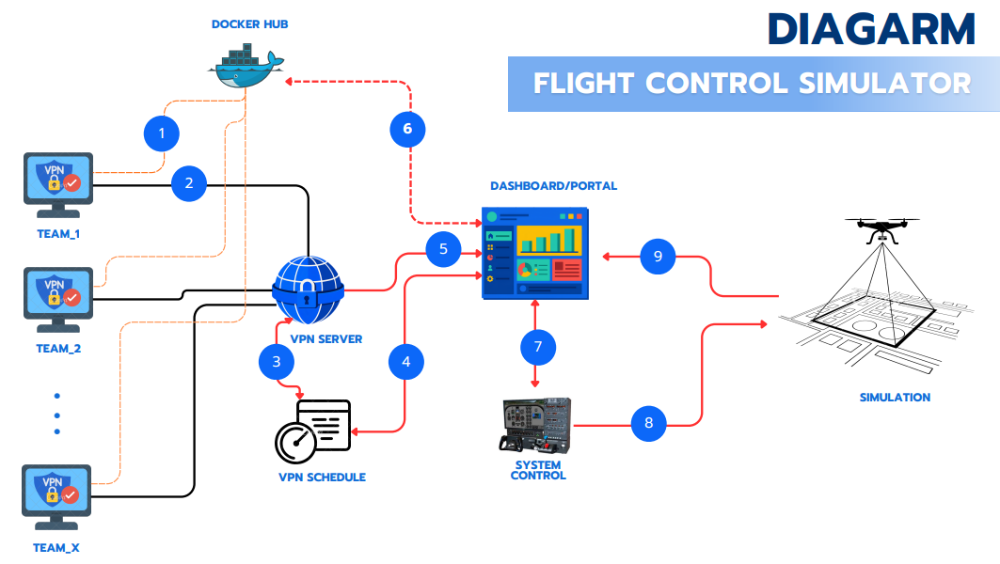

# ติดตั้ง flight-service บนเครื่องจริง (Proxmox) ให้ website เรียกด้วย curl

> ร่าง 2026-10-24 · ยังไม่ได้ลองบนเครื่องจริง · ข้อที่ไม่รู้ระบุเป็น "รอยืนยัน"
> ที่มา: diagram ของผู้จัด `../image.png` (สรุปการแข่งใน [competition.md](competition.md)) · ฐานคือ README หัวข้อ "ย้ายไปเครื่องใหม่" และ `scripts/preflight.sh`

## 1. เป้าหมาย

เอาโค้ด flight-service ไปรันบน**เครื่อง sim จริง** (มี Isaac Sim 6 + PegasusSimulator + PX4 เหมือนเครื่องนี้ แต่อยู่ใน Proxmox 9.2) ให้ระบบ Dashboard/Portal ของผู้จัดสั่งงานด้วย curl



| ขั้นใน diagram | ใครทำ | ของเรา |
|---|---|---|
| 1 ทีม push image ขึ้น Docker Hub | ทีม | — |
| 2–5 VPN, VPN Schedule, เข้า Portal | ผู้จัด | — |
| 6 Portal ไป Docker Hub | ผู้จัด | ส่งชื่อ image ให้เราไป pull เอง (รอยืนยันว่าใครถือ image) |
| 7 Portal ↔ System Control | ผู้จัด → **เรา** | `POST /jobs`, `POST /kill`, `GET /jobs/{id}`, `GET /healthz` |
| 8 System Control → Simulation | **เรา** | `sim.py` + `flightsession.py` + `vendor/drone-sitl` |
| 9 Simulation → Portal | **เรา** | `GET /jobs/{id}/stream` (SSE) · `/files/*` (MP4, journal) · `result` |

flight-service รับบทเป็น System Control + Simulation (ขั้น 7–9) ทีมไม่ต่อถึงเราโดยตรง เรียกเราได้เฉพาะ Portal

## 2. ภาพรวมที่ต้องมีบน Proxmox

- **VM (แนะนำ) ที่ทำ PCIe passthrough ให้ GPU ทั้งใบ** ไม่ใช่ LXC: Docker + nvidia-container-toolkit ใน LXC ต้องตั้ง nesting และ driver ให้ตรงกับ host เอง ซึ่งยุ่งและพังง่าย VM ใช้ได้เหมือนเครื่องจริง คู่มือ README ใช้ได้ตามเดิม
- Ubuntu ใน VM ลง NVIDIA driver, Docker, nvidia-container-toolkit, ffmpeg, conda env `drone`
- CPU type `host` · RAM ขั้นต่ำ 64 GB (container ของ agent จำกัด 24 GB `--memory 24g` ส่วน Isaac กินอีกก้อน) · ดิสก์: Isaac ~50 GB + image + `MIN_FREE_GB=40` + `data/runs` ≤ 10 GB
- **รอยืนยัน:** เป็น VM หรือ LXC · GPU รุ่นอะไร passthrough แล้วหรือยัง

## 3. ขั้นติดตั้ง

ทำตาม README หัวข้อ "ย้ายไปเครื่องใหม่" (ติดตั้งครั้งแรก) ครบทุกขั้น ย่อไว้ดังนี้:

1. ลง Isaac Sim 6 (`~/isaac-sim6`) · PegasusSimulator · PX4-Autopilot build `px4_sitl_default` · conda env `drone` · Docker + nvidia-container-toolkit + ffmpeg
2. คัดลอก repo (git clone หรือ copy ทั้งโฟลเดอร์)
3. แผนที่ใหญ่ที่ไม่อยู่ใน git: เครื่องนี้ `tar -C vendor/maps -cf nt-testgs-map.tar nt-testgs` → เครื่องจริง `tar -C vendor/maps -xf nt-testgs-map.tar` (ตรวจด้วย `SHA256SUMS`)
4. image ฐานของ bundle: `cd vendor/drone-sitl && docker build -t competition-base:latest -f docker/competition-base/Dockerfile .`
5. `cp .env.example .env` แล้วตั้งค่าตามหัวข้อ 4
6. `./scripts/preflight.sh` จนขึ้น `preflight: ready` (ทุกข้อที่ไม่ผ่านมีบรรทัด `fix:`)
7. ทดสอบในเครื่องก่อนเปิดให้ข้างนอก: `./scripts/run-service.sh` แล้ว `./scripts/flight.py run <image>` ให้บินจบ `done` อย่างน้อย 1 รอบ

## 4. ค่า `.env` ที่ต้องเปลี่ยนจากเครื่องนี้

| ค่า | เครื่องนี้ | เครื่องจริง | เหตุผล |
|---|---|---|---|
| `RUNNER_HOST` | `127.0.0.1` | IP ของ VM ที่ Portal ถึง (ไม่ใช้ `0.0.0.0`) | ไม่มี login ด่านเดียวคือ bind + firewall |
| `ALLOWED_IMAGES` | `perkiepai/...` (default) | regex ของ repo ทีมจริง คั่นด้วยช่องว่าง | ไม่ตั้ง = รับแค่ `perkiepai/` |
| path ของ Isaac/Pegasus/PX4 | default | ตั้ง `ISAAC_DIR`, `PEGASUS_EXTS` ถ้าไม่ตรง | preflight บอกถ้าผิด |
| `docker login` | `perkiepai/*` private | login registry ของทีม ถ้า private | pull ต้องมี credential |

รอยืนยัน: pattern ของ image ที่ทีมจะใช้ (ใครตั้งชื่อ repo) และต้องมี credential หรือไม่

## 5. เครือข่ายและความปลอดภัย

- **firewall สองชั้น:** Proxmox firewall ของ VM + `ufw`/`iptables` ใน VM เปิด `8095/tcp` เฉพาะ IP ของเครื่อง Portal/System Control ทุกคนที่ถึง port นี้สั่งงานได้ (design §7)
- ไม่มี TLS: ถ้าเส้นทางไป Portal ผ่านเครือข่ายที่ไม่เชื่อถือ ต้องคิดเรื่อง VPN/WireGuard ของผู้จัดหรือ reverse proxy แยก (รอยืนยัน)
- container ของ agent ใช้ `--network host` จึงเห็น service อื่นบน VM ทั้งหมด **อย่าลง service อื่นบน VM นี้** (postgres, ollama ฯลฯ)
- ข้อจำกัดที่รู้อยู่แล้ว: โปรเจกต์อื่นเปิด Isaac ทับระหว่างบินจะฆ่างานเรา (`sim_busy` กันได้แค่ตอนเริ่มงาน) → VM นี้ควรใช้แค่ flight-service

## 6. เปิดอัตโนมัติและเฝ้าระวัง

- `scripts/run-service.sh` เปิดเบื้องหลังแต่**ไม่ขึ้นเองหลังรีบูต** ต้องทำเป็น systemd unit (ยังไม่มีในโค้ด) · ตั้ง "Start at boot" ที่ Proxmox ของ VM
- เช็กสุขภาพ: `curl http://<IP>:8095/healthz` → `{"ok","ready","phase","pending"}` · `phase: degraded` ต้องมีคนแก้
- ปิดระหว่างบินได้ รอบหน้า service กู้ผลจาก journal เป็น `failed / runner_restarted`
- **GPU หลุด (Xid 79):** เคยเกิดที่เครื่องนี้ (RTX 5090) กลางบิน งานจบ `agent_crashed` ใน VM การกู้ต้องทำที่ host Proxmox (reset GPU / รีสตาร์ท VM) ไม่ใช่ใน VM · รอยืนยันกับผู้ดูแลว่ากู้อย่างไรและมีใครเฝ้า
- snapshot ของ VM หลังติดตั้งและ preflight ผ่าน เพื่อย้อนกลับถ้า driver หรือ Isaac พัง

## 7. สิ่งที่ website ต้องรู้ (สัญญาของ API)

ดู [design.md](../design.md) หัวข้อ 3 · สรุป:

```bash
R=http://<IP>:8095
curl -s $R/healthz                                  # ready: true = ส่งงานได้
curl -s -X POST $R/jobs -H 'Content-Type: application/json' \
     -d '{"image":"<repo>/<name>:<tag>","flight_timeout_s":600}'      # 202 {"job_id"}
curl -s $R/jobs/<id>                                # สถานะ + telemetry ล่าสุด + result
curl -sN $R/jobs/<id>/stream                        # SSE สด
curl -s -X POST $R/jobs/<id>/kill                   # หรือ POST $R/kill
curl -s -o clip.mp4 $R/jobs/<id>/files/detections.mp4
```

- ช่องรอมี 1 งาน (`MAX_PENDING=1`) เต็มตอบ `409` → Portal ถือคิวไว้เอง แล้วส่งใหม่เมื่อ `ready: true`
- ทุกงานบูต sim ใหม่ 2–5 นาที · งานจบ (`done`/`failed`/`killed`) = cleanup เสร็จแล้ว ส่งงานถัดไปได้ทันที
- **ขั้น 9 ใน diagram ลูกศรชี้จาก Simulation เข้า Portal:** ของเราเป็นแบบ Portal มา poll หรือต่อ SSE · ถ้า Portal ต้องการให้เราส่งกลับ (callback) ต้องเพิ่มเป็นฟีเจอร์ใหม่ (ยังไม่มี)

## 8. ที่ยังไม่รู้ / ยังไม่ได้ทำ

| เรื่อง | สถานะ |
|---|---|
| website ส่ง curl แบบชื่อ image หรือไฟล์ · รอผลแบบ poll/SSE หรือ callback | รอคำตอบ |
| ใครถือ image (Portal pull ขั้น 6 แล้ว เรา pull ซ้ำ หรือ Portal ส่งไฟล์) | รอยืนยัน |
| รูปแบบ body ของ Mission Scenario (ขั้น 7) | รอยืนยัน |
| คะแนน: `score.py` มีแค่ detection (20% ของคะแนน) ภารกิจ/เส้นทาง/เวลา/เสถียรภาพไม่มี | ต้องรู้นิยามจากผู้จัดก่อน |
| ผูกผลกับทีม | `job_id` ↔ ทีมจับคู่ที่ระบบพี่ต้น · วิธีลบ `data/runs/` พักไว้ (wishlist 4) |
| systemd unit | ยังไม่ทำ |
| ทดสอบบน VM จริง | ยังไม่ทำ |
